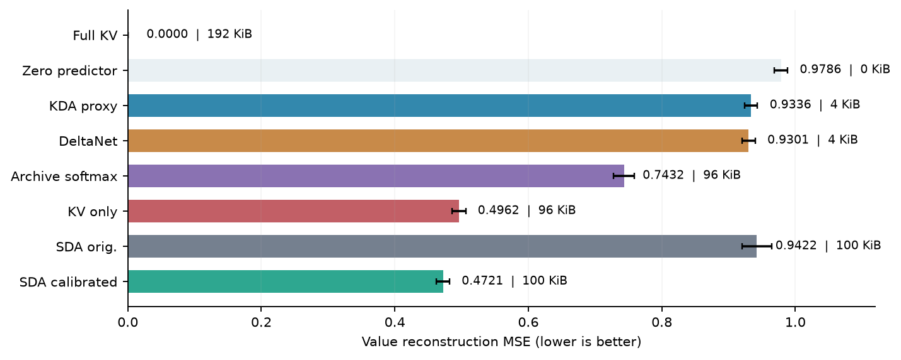
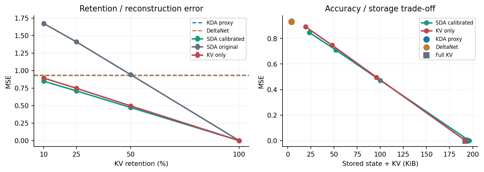
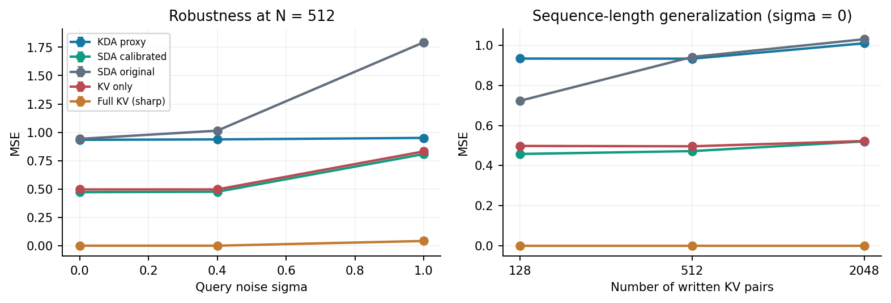

# Summer Delta Attention (SDA)
[](https://doi.org/10.5281/zenodo.23613123)

**Author: summer** · MIT License · research reference / unreviewed manuscript

Summer Delta Attention v5-Gated (SDA-5) combines a **no-decay delta-rule fast-weight state** with a **bounded archive of original key/value pairs** and a **confidence-gated residual correction**. This repository is an educational research prototype, not a pretrained LLM or optimized linear-attention kernel.

## Face-wise synthetic results (front claim)

Equal-memory synthetic recall at σ=0. Not a language-model result. A hard-face win is not an overall best: the winner changes with the face. Sources: [`papers/SDA5_M-L1_limitations_JA.md`](papers/SDA5_M-L1_limitations_JA.md), [`BEST_RESULTS.md`](BEST_RESULTS.md).

| Face | Best | Representative result | Evidence |
|---|---|---|---|
| hard (rewrite + distractor, n=2048) | **SDA-Recency** | MSE **0.575 ± 0.020** (next: Recency KV 0.651, Expanded 0.686) | `research/eqmem_hard_v2/` |
| iid (uniform past) | **Expanded DeltaNet** | 512/128: Expanded 0.594 / SDA-Recency 0.680; 512/256: Expanded 0.415 | `research/hybrid_rf/` |
| old-skew | **Expanded DeltaNet** | 512/128: Expanded 0.645 / SDA-Recency 0.946 | `research/recency_adverse_v2/` |

Non-claims, carried over from the limitations note:

- No universal equal-memory kernel. H′, Hybrid-RF, and Cond2 are No-go. H (reading the hard face as the global winner) is not eligible as the main kernel.
- No language-model efficacy and no trained-layer efficacy.
- Do not use 「有望な中間」, 「全面勝ち」, 「万能SOTA」, or 「KDAに勝った」 as claims about this work.
- The figures and the table **below** are an older unequal-memory proxy study (about 100 KiB vs 4 KiB). They are not the front claim and they are not a win over Kimi Linear or KDA.

## Related linear attention (citations only)

- **DeltaNet** — delta-rule fast weights (Schlag, Irie, Schmidhuber, ICML 2021) and the parallel sequence algorithm (Yang, Wang, Zhang, Shen, Kim, NeurIPS 2024, arXiv:2406.06484).
- **Gated DeltaNet** — Yang, Kautz, Hatamizadeh, ICLR 2025, arXiv:2412.06464.
- **Kimi Linear / KDA** — Kimi Team, 2025, arXiv:2510.26692. This repository does not depend on that kernel. The 4 KiB channel-decay proxy later on this page is not Kimi Linear.

## Algorithm

For normalized keys `k` and queries `q`, with `F` of shape `(d_key, d_value)`:

```text
error = v - F.T @ k
F     = F + beta * outer(k, error)              # no multiplicative decay
j     = argmax_i cosine(q, archived_key[i])     # exact archive scan
accept = cosine(q, archived_key[j]) >= tau
out    = F.T @ q + accept * (archived_value[j] - F.T @ archived_key[j])
```

The archive is maintained by uniform reservoir sampling with a fixed maximum capacity. **It is not a constant-memory exact-recall solution:** it incurs `O(B(d_key+d_value))` archive memory and `O(B*d_key)` query-search work, in addition to the `O(d_key*d_value)` delta-state update. Exact retrieval of an archived key algebraically recovers its saved value, but this does not generalize to unseen or missing keys.

## Quick start

```bash
python -m pip install -e ".[research]"   # research extra: pandas + matplotlib (library alone needs only NumPy)
python -m examples.quickstart
python -m unittest discover -s tests -v
```

Python >=3.10 and NumPy >=1.24 are required. The [reference module](summer_delta_attention/reference.py) exposes `SummerDeltaAttention`, `kda_proxy_state` and `full_kv_attention`.

## Experiment figures

The following PNG plots are included in this repository under [`assets/readme/`](assets/readme/). They are derived from the **16-seed synthetic benchmark**, not language-model training. Reproduce the figures using `research/summary_results.csv` and `research/figures.py`.

The plots below belong to the **demoted unequal-memory proxy study**, not to the face-wise table above.

### Historical proxy figure: SDA vs a 4 KiB channel-decay stand-in

<p align="center">
  
</p>

**Figure 1.** In the synthetic exact-key recall benchmark, calibrated SDA-5 with a 50% archive reaches **0.4721 ± 0.0099** MSE, compared with **0.9336 ± 0.0098** for the KDA-style recurrent proxy. The README figure highlights the central caveat: SDA improves recall here by using a substantially larger external archive.

### Memory / accuracy Pareto view

<p align="center">
  
</p>

**Figure 2.** This plot visualizes the trade-off between value-reconstruction error and total state-plus-storage footprint. KDA and no-decay DeltaNet remain compact (**4 KiB**) but have higher reconstruction error, whereas SDA lowers error by spending additional archive memory.

### Noise and sequence-length scaling

<p align="center">
  
</p>

**Figure 3.** The third figure summarizes sensitivity to query noise and scaling with sequence length under the study protocol in `research/experiment.py`. These are controlled synthetic experiments, not downstream language-model evaluations.

## Manuscripts / 論文

- [English academic paper (PDF)](papers/Summer_Delta_Attention_vs_KDA_EN.pdf) · [English Markdown](papers/SDA_vs_KDA_EN.md)
- [日本語論文 (PDF)](papers/Summer_Delta_Attention_vs_KDA_JA.pdf) · [日本語Markdown](papers/SDA_vs_KDA_JA.md)
- [Prior numerical study and reproduction script](research/experiment.py) (NumPy and pandas; its reported results use **16 held-out random seeds**, separate development calibration, and an untrained channel-gated KDA recurrence **proxy**)

- [How it works / 仕組み (docs/wiki)](docs/wiki/Home.md) — bilingual explanation of the mechanism

The included 5-page bilingual PDF papers contain the academic figures and full study; the Markdown versions give GitHub-readable equations, protocol, key measurements, and citations.

## Historical unequal-memory proxy table (demoted, not a win)

This table is the early exact-key study. SDA's archive is about 25× the proxy's state. It is not evidence that SDA beat Kimi Linear, KDA, or full attention, and it is not the front claim. The front claim is the face-wise table near the top of this file.

| Method | Value MSE (n=512, exact-key queries) | State + stored KV (KiB) |
| --- | ---: | ---: |
| SDA-5 calibrated, 50% original KV archived | **0.4721 ± 0.0099** | 100 |
| Indexed KV, zero fallback, same archive | 0.4962 ± 0.0101 | 96 |
| KDA-style channel-decay proxy (untrained) | 0.9336 ± 0.0098 | **4** |
| No-decay DeltaNet, calibrated | 0.9301 ± 0.0098 | **4** |
| Zero predictor (always outputs 0) | 0.9786 ± 0.0098 | 0 |
| Softmax over the same retained KV (no gate, no fast state) | 0.7432 ± 0.0155 | 96 |

These values come from the **separate benchmark** in `research/experiment.py`, not from `examples/quickstart.py`. KDA uses a deterministic development-calibrated gate, **not** a trained Kimi Linear implementation. SDA uses 25× the nominal state+KV capacity of the proxy. The sharp full-KV softmax comparator is not an equal-memory or trained full Transformer. The observed result **does not prove SDA is superior to KDA** or that the full hybrid is linear-time.

## Reproduce prior synthetic study

```bash
python -m pip install numpy pandas matplotlib
OPENBLAS_NUM_THREADS=1 python research/experiment.py
OPENBLAS_NUM_THREADS=1 python research/figures.py
```

The script writes `configuration.json`, `raw_results.csv`, `summary_results.csv` and `paired_results.csv` (per-seed paired differences with 95% Student-t intervals) next to itself; all four are committed so the numbers can be audited. `tests/test_artifacts.py` fails if the committed CSV, `figures.py` and the README headline numbers drift apart, and `tests/test_reference.py` checks that the packaged class agrees with the benchmark's SDA implementation.

## How to read the results (added after adversarial review)

- **The headline gap is mostly archive size.** Indexed-KV error is about `1 − hit rate`. The fast delta state improves misses by only ~5% and is barely better than the zero predictor (0.930 vs 0.979 MSE). Paired difference of SDA over indexed KV: **+0.0241 [0.0217, 0.0265]** at n=512, but **+0.0019 [−0.0011, 0.0050]** at n=2048 (indistinguishable from zero).
- **Hard gate vs soft attention.** With the full archive (ρ=1; 196 KiB for SDA vs 192 KiB for full KV) and query noise σ=1, SDA reaches 0.665 MSE (n=512) while plain softmax attention reaches 0.0415; the gate accepts only 29.6% of queries although the correct key is retrieved 97.5% of the time. The threshold was calibrated on σ∈{0, 0.4} at 50% retention only. On a *partial* archive (ρ=0.5, σ=0) softmax over the retained KV is much worse (0.743) than gated retrieval.
- **Task bias.** Queries are uniform over all past keys with i.i.d. random keys/values: no recency, overwrites, distractors or anisotropic keys. Calibration of the "KDA proxy" therefore selects almost no forgetting, and the proxy (time-invariant per-channel decay) is not Kimi Delta Attention.
- **Capacity.** d_k=32 holds ~32 associations but 512–2048 are written; no equal-memory baseline with a larger state or a recency/eviction-policy KV cache is included.

## Errata / changes in 0.1.1

- Fixed: rewriting an archived key now **overwrites** its slot. Previously the oldest value for a duplicate key was returned and the correction cancelled the freshly updated delta state. (Behaviour change: duplicates no longer consume archive capacity.)
- Fixed: normalisation no longer overflows for huge finite vectors; the archive is a preallocated array (no per-read `np.stack`); `kda_proxy_state` validates that keys are L2-normalised.
- Fixed: `research/summary_results.csv` was stale (method names differed from `experiment.py`, KDA identical to DeltaNet, so `figures.py` could not run and the README's 0.9336 was absent). It is regenerated; the README/manuscript numbers reproduce, including the paired intervals. `raw_results.csv`, `configuration.json` and the new `paired_results.csv` are now committed.
- Added: zero-predictor and same-archive softmax baselines; reservoir-uniformity, overwrite, gate, dtype and overflow tests; library-vs-benchmark equivalence test.
- Not changed: the PDF/Markdown manuscripts (their reported numbers were re-checked against the regenerated CSV, but they do not include the two new baselines), and the open limitations above.

See [study protocol](papers/SDA_vs_KDA_EN.md) for the dev/test split, confidence gate, fairness limitations and references. Reports and implementations are experimental and should be cited as unreviewed work.
