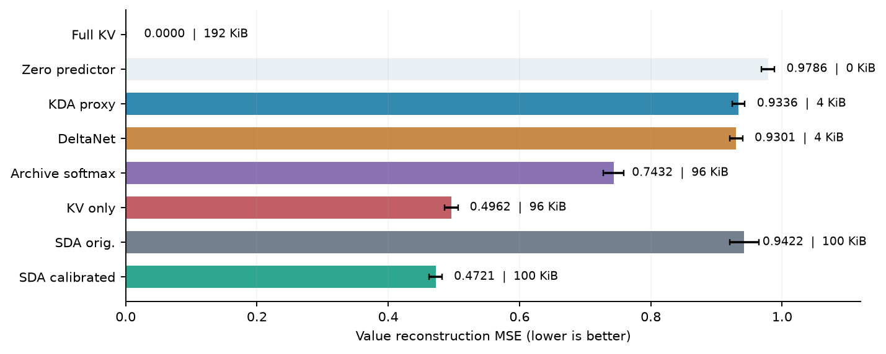
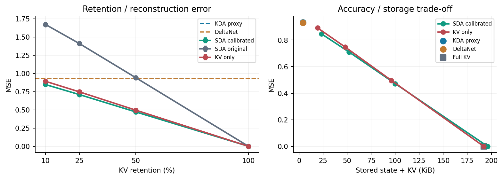
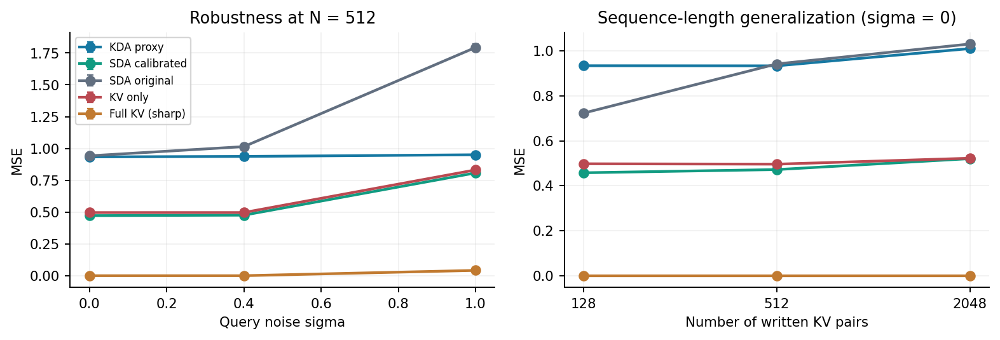

# Summer Delta Attention (SDA)
[](https://doi.org/10.5281/zenodo.23613123)

**Author: summer** · MIT License · research reference / unreviewed manuscript

Summer Delta Attention v5-Gated (SDA-5) combines a **no-decay delta-rule fast-weight state** with a **bounded archive of original key/value pairs** and a **confidence-gated residual correction**. This repository is an educational research prototype, not a pretrained LLM or optimized linear-attention kernel.

## Algorithm

For normalized keys `k` and queries `q`, with `F` of shape `(d_key, d_value)`:

```text
error = v - F.T @ k
F     = F + beta * outer(k, error)              # no multiplicative decay
j     = argmax_i cosine(q, archived_key[i])     # exact archive scan
accept = cosine(q, archived_key[j]) >= tau
out    = F.T @ q + accept * (archived_value[j] - F.T @ archived_key[j])
```

The archive is maintained by uniform reservoir sampling with a fixed maximum capacity. **It is not a constant-memory exact-recall solution:** it incurs `O(B(d_key+d_value))` archive memory and `O(B*d_key)` query-search work, in addition to the `O(d_key*d_value)` delta-state update. Exact retrieval of an archived key algebraically recovers its saved value, but this does not generalize to unseen or missing keys.

## Quick start

```bash
python -m pip install -e ".[research]"   # research extra: pandas + matplotlib (library alone needs only NumPy)
python -m examples.quickstart
python -m unittest discover -s tests -v
```

Python >=3.10 and NumPy >=1.24 are required. The [reference module](summer_delta_attention/reference.py) exposes `SummerDeltaAttention`, `kda_proxy_state` and `full_kv_attention`.

## Batched reads / 読み取りのバッチ化

For many independent queries against the same state, replace the Python loop
with `SummerDeltaAttention.read_batch`:

```python
# queries: (n_queries, key_dim); write the stream before calling this.
outputs = sda.read_batch(queries, batch_size=256, archive_block_size=4096)
outputs, info = sda.read_batch(queries, details=True)
# outputs and info["fast"]: (n_queries, value_dim)
# info["similarity"] and info["accepted"]: (n_queries,)
```

This path normalizes queries in batches and uses matrix products for archive
search and state readout. It scans the full archive in tiles, with a score
workspace bounded by `batch_size * archive_block_size` elements (4 MiB at the
defaults in float32). Input/output arrays, diagnostics and other temporaries
are additional. The recurrence, reservoir, overwrite rules and correction
equation are unchanged. Near-ties and gate-boundary decisions use the original
scalar read path; other outputs may differ by floating-point roundoff.

On one Ryzen 5 3600 CPU with one OpenBLAS thread, a 256-query float32 benchmark
observed **12.35×** speedup at 512 archived pairs and **5.57×** at 4,096 pairs.
These are medians of per-seed speedups over three seeds, not universal latency
guarantees. Setup/writes are excluded. See [conditions and seed-level evidence](docs/benchmarks/batched-reads.md).

```bash
OPENBLAS_NUM_THREADS=1 OMP_NUM_THREADS=1 MKL_NUM_THREADS=1 python -m research.benchmark_reads
python -m unittest discover -s tests -v
```

Use `read()` for single-query/online write-read workloads. Batching across
intervening writes would change the meaning of those reads. The API is for
`SummerDeltaAttention`; `SummerDeltaAttentionPlus` does not expose it.
No new library dependencies are required. Tie-heavy inputs and thresholds near
typical similarities can reduce the benefit by triggering scalar fallbacks.

同じ状態に対する複数クエリをまとめて処理するAPIです。検索の近似化は行わず、
クエリ側・アーカイブ側の両方を分割して一時メモリを制限します。
速度の数値は特定CPU・合成入力での測定で、書き込み時間は含みません。

## Experiment figures

The following PNG plots are included in this repository under [`assets/readme/`](assets/readme/). They are derived from the **16-seed synthetic benchmark**, not language-model training. Reproduce the figures using `research/summary_results.csv` and `research/figures.py`.

### Main comparison: SDA vs KDA

<p align="center">
  
</p>

**Figure 1.** In the synthetic exact-key recall benchmark, calibrated SDA-5 with a 50% archive reaches **0.4721 ± 0.0099** MSE, compared with **0.9336 ± 0.0098** for the KDA-style recurrent proxy. The README figure highlights the central caveat: SDA improves recall here by using a substantially larger external archive.

### Memory / accuracy Pareto view

<p align="center">
  
</p>

**Figure 2.** This plot visualizes the trade-off between value-reconstruction error and total state-plus-storage footprint. KDA and no-decay DeltaNet remain compact (**4 KiB**) but have higher reconstruction error, whereas SDA lowers error by spending additional archive memory.

### Noise and sequence-length scaling

<p align="center">
  
</p>

**Figure 3.** The third figure summarizes sensitivity to query noise and scaling with sequence length under the study protocol in `research/experiment.py`. These are controlled synthetic experiments, not downstream language-model evaluations.

## Manuscripts / 論文

- [English academic paper (PDF)](papers/Summer_Delta_Attention_vs_KDA_EN.pdf) · [English Markdown](papers/SDA_vs_KDA_EN.md)
- [日本語論文 (PDF)](papers/Summer_Delta_Attention_vs_KDA_JA.pdf) · [日本語Markdown](papers/SDA_vs_KDA_JA.md)
- [Prior numerical study and reproduction script](research/experiment.py) (NumPy and pandas; its reported results use **16 held-out random seeds**, separate development calibration, and an untrained channel-gated KDA recurrence **proxy**)

- [How it works / 仕組み (docs/wiki)](docs/wiki/Home.md) — bilingual explanation of the mechanism

The included 5-page bilingual PDF papers contain the academic figures and full study; the Markdown versions give GitHub-readable equations, protocol, key measurements, and citations.

## Synthetic recall results (not a language-model benchmark)

| Method | Value MSE (n=512, exact-key queries) | State + stored KV (KiB) |
| --- | ---: | ---: |
| SDA-5 calibrated, 50% original KV archived | **0.4721 ± 0.0099** | 100 |
| Indexed KV, zero fallback, same archive | 0.4962 ± 0.0101 | 96 |
| KDA-style channel-decay proxy (untrained) | 0.9336 ± 0.0098 | **4** |
| No-decay DeltaNet, calibrated | 0.9301 ± 0.0098 | **4** |
| Zero predictor (always outputs 0) | 0.9786 ± 0.0098 | 0 |
| Softmax over the same retained KV (no gate, no fast state) | 0.7432 ± 0.0155 | 96 |

These values come from the **separate benchmark** in `research/experiment.py`, not from `examples/quickstart.py`. KDA uses a deterministic development-calibrated gate, **not** a trained Kimi Linear implementation. SDA uses 25× the nominal state+KV capacity of the proxy. The sharp full-KV softmax comparator is not an equal-memory or trained full Transformer. The observed result **does not prove SDA is superior to KDA** or that the full hybrid is linear-time.

## Reproduce prior synthetic study

```bash
python -m pip install numpy pandas matplotlib
OPENBLAS_NUM_THREADS=1 python research/experiment.py
OPENBLAS_NUM_THREADS=1 python research/figures.py
```

The script writes `configuration.json`, `raw_results.csv`, `summary_results.csv` and `paired_results.csv` (per-seed paired differences with 95% Student-t intervals) next to itself; all four are committed so the numbers can be audited. `tests/test_artifacts.py` fails if the committed CSV, `figures.py` and the README headline numbers drift apart, and `tests/test_reference.py` checks that the packaged class agrees with the benchmark's SDA implementation.

## SDA+ (experimental, opt-in)

`SummerDeltaAttentionPlus` (`summer_delta_attention/plus.py`) is an additive variant; `SummerDeltaAttention` is unchanged. It keeps the same delta state and reservoir archive and adds four switchable pieces: an int8/int4 quantized archive (more retained KV per byte), a k-means clustered read (scan only `probe` clusters), a soft sigmoid confidence gate, and a top-m softmax correction.

```python
from summer_delta_attention import SummerDeltaAttentionPlus as Plus
cap = Plus.capacity_for_budget(272 * 1024, 64, 64, bits=4, dtype="float32")
sda_plus = Plus(64, 64, capacity=cap, bits=4, dtype="float32")
```

Equal-memory synthetic recall, top-1 retrieval of the written value from a noisy key (N=16384, query noise σ=0.3, 2 seeds × 128 queries; `OPENBLAS_NUM_THREADS=1 python research/plus_equal_memory.py`, ~20 s on CPU):

| Byte budget | SDA original (float32) | SDA+ int8 | SDA+ int4 | SDA+ int4, no state, no gate |
|---|---:|---:|---:|---:|
| 272 KiB | 0.043 | 0.109 | 0.246 | 0.238 |
| 2064 KiB | 0.223 | 0.922 | 1.000 | 1.000 |

How to read this (please do not over-claim):

- **The gain is archive capacity.** Recall tracks the fraction of the N pairs that fit in the budget (512 → 1848 → 3434 archived pairs at 272 KiB). The last column, a plain quantized clustered KV archive with no delta state and no gate, matches the full variant, so the benchmark gives **no evidence that the delta state, the soft gate or top-m help**.
- At 2064 KiB / int4 all N=16384 pairs are archived, so that cell is an upper bound set by the task, not a property of the gate.
- Synthetic i.i.d.-style recall only (64 topic clusters, no recency, overwrites or distractors); not a language-model benchmark. Byte counts are payload (packed bits + fp16 scales) plus the cluster index; the NumPy reference stores int4 codes in int8 arrays, and no trained KDA/Kimi Linear is involved.
- Reads rebuild the k-means index lazily after writes, so write-heavy interleaved workloads pay that cost; no latency claim is made.

## How to read the results (added after adversarial review)

- **The headline gap is mostly archive size.** Indexed-KV error is about `1 − hit rate`. The fast delta state improves misses by only ~5% and is barely better than the zero predictor (0.930 vs 0.979 MSE). Paired difference of SDA over indexed KV: **+0.0241 [0.0217, 0.0265]** at n=512, but **+0.0019 [−0.0011, 0.0050]** at n=2048 (indistinguishable from zero).
- **Hard gate vs soft attention.** With the full archive (ρ=1; 196 KiB for SDA vs 192 KiB for full KV) and query noise σ=1, SDA reaches 0.665 MSE (n=512) while plain softmax attention reaches 0.0415; the gate accepts only 29.6% of queries although the correct key is retrieved 97.5% of the time. The threshold was calibrated on σ∈{0, 0.4} at 50% retention only. On a *partial* archive (ρ=0.5, σ=0) softmax over the retained KV is much worse (0.743) than gated retrieval.
- **Task bias.** Queries are uniform over all past keys with i.i.d. random keys/values: no recency, overwrites, distractors or anisotropic keys. Calibration of the "KDA proxy" therefore selects almost no forgetting, and the proxy (time-invariant per-channel decay) is not Kimi Delta Attention.
- **Capacity.** d_k=32 holds ~32 associations but 512–2048 are written; no equal-memory baseline with a larger state or a recency/eviction-policy KV cache is included.

## Errata / changes in 0.1.1

- Fixed: rewriting an archived key now **overwrites** its slot. Previously the oldest value for a duplicate key was returned and the correction cancelled the freshly updated delta state. (Behaviour change: duplicates no longer consume archive capacity.)
- Fixed: normalisation no longer overflows for huge finite vectors; the archive is a preallocated array (no per-read `np.stack`); `kda_proxy_state` validates that keys are L2-normalised.
- Fixed: `research/summary_results.csv` was stale (method names differed from `experiment.py`, KDA identical to DeltaNet, so `figures.py` could not run and the README's 0.9336 was absent). It is regenerated; the README/manuscript numbers reproduce, including the paired intervals. `raw_results.csv`, `configuration.json` and the new `paired_results.csv` are now committed.
- Added: zero-predictor and same-archive softmax baselines; reservoir-uniformity, overwrite, gate, dtype and overflow tests; library-vs-benchmark equivalence test.
- Not changed: the PDF/Markdown manuscripts (their reported numbers were re-checked against the regenerated CSV, but they do not include the two new baselines), and the open limitations above.

See [study protocol](papers/SDA_vs_KDA_EN.md) for the dev/test split, confidence gate, fairness limitations and references. Reports and implementations are experimental and should be cited as unreviewed work.
