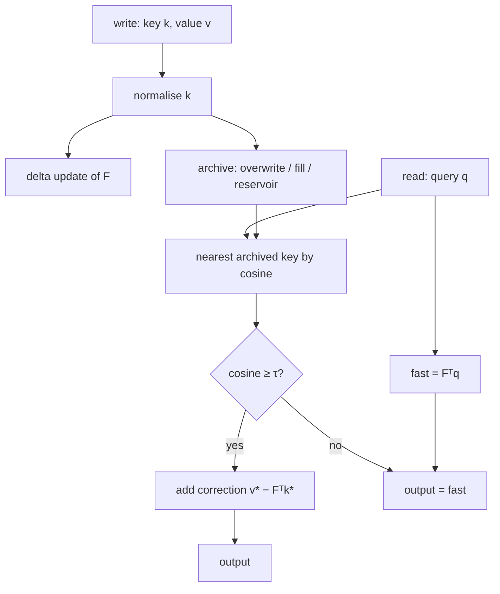

[🇯🇵 日本語版: 仕組み](仕組み.md) · [Home](Home.md)

# How it works

Summer Delta Attention v5-Gated (SDA-5) answers a query from **two memories** and a **gate** that decides whether to trust the second one:

| Component | What it is | Size |
| --- | --- | --- |
| **Fast state** `F` | A no-decay delta-rule fast-weight matrix, `d_key × d_value` | constant |
| **Archive** | A bounded set of *original* key/value pairs kept by reservoir sampling | `B` pairs |
| **Gate** | "Is the nearest archived key similar enough to the query?" (cosine ≥ `τ`) | — |

> This repository is an educational NumPy reference. It is not a trained model and not an optimized kernel.



## 1. Writing a token

For a normalised key `k` (unit length) and value `v`, with step size `β ∈ (0, 1]`:

```text
error = v − Fᵀ k              # what F currently predicts wrongly
F     = F + β · outer(k, error)   # no multiplicative decay
```

This is the classic delta rule (Widrow–Hoff / fast-weight programmer). There is **no forgetting term**, so `F` keeps accumulating; with more written pairs than key dimensions it becomes an overloaded, blurry memory.

The *original* pair is then offered to the archive (capacity `B`):

1. **Same key already archived** (cosine ≥ `1 − overwrite_tol`) → that slot's value is **overwritten** (latest write wins). *(Since v0.1.1; earlier versions kept both and returned the oldest value.)*
2. **Archive not full** → append.
3. **Archive full** → reservoir sampling (Algorithm R): the `t`-th write replaces a random slot with probability `B / t`, so every token is equally likely to be retained. There is no learned selector.

## 2. Reading a query

```text
fast   = Fᵀ q
j      = argmax_i cosine(q, archived_key[i])     # exact scan of the archive
accept = cosine(q, archived_key[j]) ≥ τ
out    = fast + accept · (archived_value[j] − Fᵀ archived_key[j])
       = Fᵀ (q − accept·k_j) + accept · v_j
```

* **Gate closed** → the answer is the fast-state prediction only.
* **Gate open** → the archived value `v_j` is used, and the fast state contributes only the *residual* `Fᵀ(q − k_j)` for how far the query is from the stored key.
* If `q` equals an archived key, the output is **exactly** the stored value. Otherwise the error against `v_j` is at most `‖F‖₂ · ‖q − k_j‖₂`. This is a consequence of storing `v_j`, not a new attention family.

## 3. Cost

| | Complexity |
| --- | --- |
| State update | `O(d_key · d_value)` per token |
| Archive memory | `O(B · (d_key + d_value))` |
| Query | `O(B · d_key)` exact scan |

The archive is **not** constant-memory: if `B` grows with context length, the scan is linear in the context, like full attention.

## 4. Parameters

| Parameter | Default | Meaning |
| --- | --- | --- |
| `capacity` | 32 | Max archived pairs `B` (0 disables the archive → plain delta rule) |
| `beta` | 0.05 | Delta step size, `0 < β ≤ 1` |
| `threshold` | 0.75 | Gate threshold `τ`, cosine in `[-1, 1]` |
| `seed` | 0 | Reservoir-sampling RNG seed |
| `overwrite_tol` | 1e-9 | Keys this close (in cosine) are treated as the same key |

```python
import numpy as np
from summer_delta_attention import SummerDeltaAttention

mem = SummerDeltaAttention(key_dim=32, value_dim=16, capacity=64, beta=0.05, threshold=0.75)
mem.write(key, value)                         # any nonzero finite vectors
out, info = mem.read(query, details=True)     # info: fast, similarity, accepted, archive_size
```

## 5. What the experiments do and do not show

On a synthetic exact-key recall task (`d_key=32`, `d_value=16`, 512 pairs, 16 held-out seeds):

| Method | Value MSE | State + KV |
| --- | ---: | ---: |
| SDA-5, 50% of KV archived | 0.4721 ± 0.0099 | 100 KiB |
| Indexed KV only (same archive, zero fallback) | 0.4962 ± 0.0101 | 96 KiB |
| Channel-decay delta-rule proxy ("KDA-style", untrained) | 0.9336 ± 0.0098 | 4 KiB |
| Zero predictor | 0.9786 ± 0.0098 | 0 |

How to read it honestly:

* The gap to the 4 KiB proxy is **mostly archive size**: indexed-KV error is about `1 − hit rate`. The fast state helps only modestly on misses.
* SDA beats "archive only" by a paired **+0.0241 [0.0217, 0.0265]** at n=512, but by **+0.0019 [−0.0011, 0.0050]** at n=2048 — indistinguishable from zero.
* With a full archive and query noise σ=1, plain softmax attention (0.0415) beats SDA (0.665) at about the same memory: the hard gate rejects most correct retrievals. The threshold was calibrated only for σ ≤ 0.4 at 50% retention.
* The "KDA" baseline is an untrained, time-invariant channel-decay delta rule, **not** Kimi Delta Attention, and nothing here shows superiority to trained models.

Full numbers, caveats and errata: see the [README](https://github.com/Summer110622/SummerDeltaAttention#readme) and the [paper](https://github.com/Summer110622/SummerDeltaAttention/blob/main/papers/SDA_vs_KDA_EN.md).
