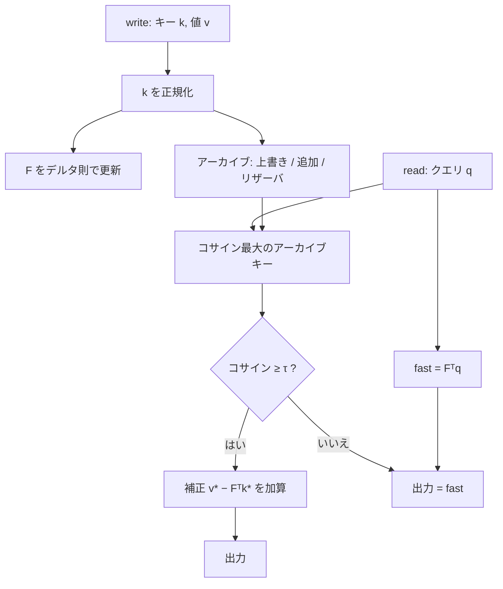

[🇬🇧 English: How it works](How-It-Works.md) · [Home](Home.md)

# 仕組み

Summer Delta Attention v5-Gated（SDA-5）は、**2種類のメモリ**と、2つ目のメモリを信用するかを決める**ゲート**でクエリに答えます。

| 構成要素 | 内容 | サイズ |
| --- | --- | --- |
| **高速状態** `F` | 忘却なしのデルタ則による高速重み行列（`d_key × d_value`） | 一定 |
| **アーカイブ** | リザーバサンプリングで保持する、*元の*キー/値ペアの有界集合 | `B` ペア |
| **ゲート** | 「最も近いアーカイブ済みキーはクエリと十分似ているか」（コサイン ≥ `τ`） | — |

> 本リポジトリは教育用のNumPy参照実装です。学習済みモデルでも最適化カーネルでもありません。



## 1. 書き込み

正規化したキー `k`（長さ1）と値 `v`、ステップ幅 `β ∈ (0, 1]` に対して：

```text
error = v − Fᵀ k                  # 現在の F の予測の誤差
F     = F + β · outer(k, error)   # 乗算的な減衰（忘却）なし
```

古典的なデルタ則（Widrow–Hoff / 高速重みプログラマ）です。**忘却項が無い**ため `F` は蓄積し続け、キー次元より多くのペアを書くと、過負荷でぼやけた記憶になります。

続いて*元の*ペアをアーカイブ（容量 `B`）に渡します。

1. **同じキーが既にアーカイブにある**（コサイン ≥ `1 − overwrite_tol`）→ そのスロットの値を**上書き**します（最新の書き込みが勝ちます）。*（v0.1.1以降。以前は両方を保持し、最も古い値を返していました。）*
2. **アーカイブに空きがある** → 追加します。
3. **アーカイブが満杯** → リザーバサンプリング（Algorithm R）：`t` 番目の書き込みは確率 `B / t` でランダムなスロットを置き換えます。どのトークンも等確率で残ります。学習された選択器はありません。

## 2. 読み出し

```text
fast   = Fᵀ q
j      = argmax_i cosine(q, archived_key[i])     # アーカイブを厳密に全走査
accept = cosine(q, archived_key[j]) ≥ τ
out    = fast + accept · (archived_value[j] − Fᵀ archived_key[j])
       = Fᵀ (q − accept·k_j) + accept · v_j
```

* **ゲートが閉じている** → 答えは高速状態の予測のみです。
* **ゲートが開いている** → アーカイブ済みの値 `v_j` を使い、高速状態は「クエリが保存キーからどれだけずれているか」の残差 `Fᵀ(q − k_j)` だけを寄与します。
* `q` がアーカイブ済みキーと一致するなら、出力は保存値と**完全に**一致します。それ以外でも `v_j` との誤差は高々 `‖F‖₂ · ‖q − k_j‖₂` です。これは `v_j` を保存していることの帰結であり、新しい注意機構の族を意味しません。

## 3. コスト

| | 計算量 |
| --- | --- |
| 状態の更新 | トークンあたり `O(d_key · d_value)` |
| アーカイブのメモリ | `O(B · (d_key + d_value))` |
| クエリ | `O(B · d_key)`（厳密な全走査） |

アーカイブは**定数メモリではありません**。`B` が文脈長とともに増えるなら、走査は全注意と同様に文脈長に比例します。

## 4. パラメータ

| パラメータ | 既定値 | 意味 |
| --- | --- | --- |
| `capacity` | 32 | アーカイブの最大ペア数 `B`（0でアーカイブ無効＝素のデルタ則） |
| `beta` | 0.05 | デルタ則のステップ幅（`0 < β ≤ 1`） |
| `threshold` | 0.75 | ゲートの閾値 `τ`（`[-1, 1]` のコサイン） |
| `seed` | 0 | リザーバサンプリングの乱数シード |
| `overwrite_tol` | 1e-9 | コサインがこの範囲で一致するキーは同一キーとみなす |

```python
import numpy as np
from summer_delta_attention import SummerDeltaAttention

mem = SummerDeltaAttention(key_dim=32, value_dim=16, capacity=64, beta=0.05, threshold=0.75)
mem.write(key, value)                         # 零でない有限のベクトル
out, info = mem.read(query, details=True)     # info: fast, similarity, accepted, archive_size
```

## 5. 実験が示すこと・示さないこと

合成の完全一致キー想起タスク（`d_key=32`、`d_value=16`、512ペア、ホールドアウト16シード）：

| 手法 | 値のMSE | 状態＋KV |
| --- | ---: | ---: |
| SDA-5（KVの50%をアーカイブ） | 0.4721 ± 0.0099 | 100 KiB |
| インデックスKVのみ（同じアーカイブ、フォールバックはゼロ） | 0.4962 ± 0.0101 | 96 KiB |
| チャネル別減衰のデルタ則プロキシ（「KDA風」、未学習） | 0.9336 ± 0.0098 | 4 KiB |
| ゼロ予測 | 0.9786 ± 0.0098 | 0 |

正直な読み方：

* 4 KiBのプロキシとの差は**ほぼアーカイブの大きさ**によります。インデックスKVの誤差はおよそ `1 − ヒット率` で、高速状態は外れたクエリを少し改善するだけです。
* 「アーカイブのみ」に対するSDAの対応あり差は、n=512 で **+0.0241 [0.0217, 0.0265]**、n=2048 では **+0.0019 [−0.0011, 0.0050]** でゼロと区別できません。
* アーカイブ全保持かつクエリノイズ σ=1 では、ほぼ同じメモリで単純なsoftmax注意（0.0415）がSDA（0.665）を上回ります。ハードゲートが正しい検索の多くを棄却するためです。閾値は 50%保持・σ ≤ 0.4 でのみ較正されています。
* 「KDA」ベースラインは未学習で時間不変のチャネル別減衰デルタ則であり、Kimi Delta Attention**ではありません**。学習済みモデルに対する優位性は何も示していません。

詳細な数値・注意点・errata は [README](https://github.com/Summer110622/SummerDeltaAttention#readme) と[論文（日本語）](https://github.com/Summer110622/SummerDeltaAttention/blob/main/papers/SDA_vs_KDA_JA.md)を参照してください。
