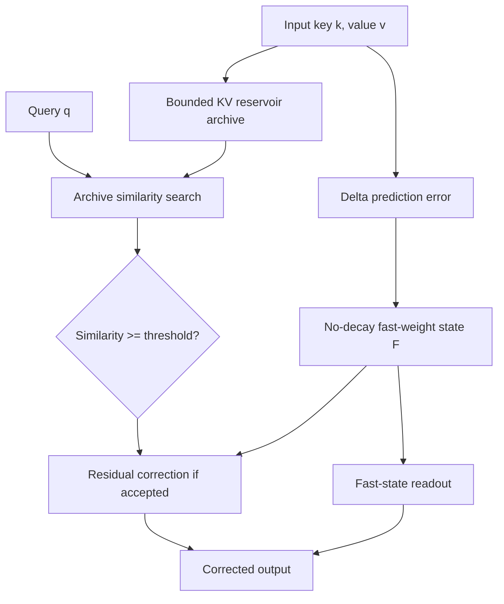

# Summer Delta Attention v5-Gated versus Kimi Delta Attention

**Author:** summer  
**Date:** 23 October 2026  
**Status:** Unreviewed research manuscript (synthetic associative-recall study)

## Abstract

Summer Delta Attention v5-Gated (SDA-5) combines a recurrent, no-decay delta-rule fast-weight matrix with a budgeted key-value archive and confidence-gated residual retrieval. We compare it with a hand-designed channel-gated recurrence based on Kimi Delta Attention (KDA), using a controlled synthetic associative-recall task. At sequence length 512, with 32-dimensional keys, 16-dimensional values, 128 exact-key queries and 16 held-out random seeds, SDA-5 retaining 50% of original key-value pairs obtains mean-squared error (MSE) **0.4721 ± 0.0099 (mean ± SEM)** versus **0.9336 ± 0.0098** for the channel-decay KDA proxy. This requires **100 KiB** of state and archived KV rather than **4 KiB**, a 25-fold storage difference. A direct KV-search control yields **0.4962 ± 0.0101** at 96 KiB. The KDA proxy is not the learned Kimi Linear architecture. These findings demonstrate an accuracy/storage trade-off on an untrained associative task, not superiority to trained KDA or Full Attention.

## 1. Proposed architecture

For `F_t ∈ R^(d_k × d_v)`, normalized `k_t`, and step size `β_t`:

\[
 e_t=v_t-F_{t-1}^{\mathsf T}k_t,\qquad
 F_t=F_{t-1}+\beta_t k_t e_t^{\mathsf T}.
\]

For an archive `A_t = {(k_i,v_i)}` and query `q`, select `i* = argmax_(i ∈ A_t) q^T k_i`. Define `g(q) = 1[q^T k_(i*) >= τ]`. Then

\[
 o_{\rm SDA}(q)=F_t^{\mathsf T}q+g(q)(v_{i^*}-F_t^{\mathsf T}k_{i^*}).
\]

The inference-time implementation scans the archive exactly. A bounded reservoir controls its number of entries, not the information-theoretic amount needed for lossless recall.

## 2. KDA comparison and interpretation

The reference KDA recurrence is

\[
 \bar S_t=\operatorname{Diag}(\boldsymbol\alpha_t)S_{t-1},\qquad
 S_t=\bar S_t+\beta_t k_t(v_t-\bar S_t^{\mathsf T}k_t)^{\mathsf T}.
\]

Our **untrained proxy** uses a deterministic decay schedule

\[
 \alpha_{t,j}=\exp[-\ell c_j(1+\eta\sqrt{d_k}|k_{t,j}|)],
 \quad c_j\in[0.5,1.5].
\]

The development-selected positive-decay setting is `β=0.05`, `ℓ=0.0005`, `η=0`. This is a channel-wise but **time-invariant** gate in the final setting. It does not train projections, learned gate parameters, convolutional layers or the MLA layers used in the actual Kimi Linear model.

## 3. Experimental protocol

Generate `N ∈ {128, 512, 2048}` independent standard-normal keys in `R^32`, normalize each to unit length, and generate independent standard-normal values in `R^16`. Sample 128 source indices with replacement. Queries are normalized `q=(k_j + σ z / sqrt(32))/||k_j + σ z / sqrt(32)||`, with `z ~ N(0,I)` and `σ ∈ {0,0.4,1}`; targets are the original values `v_j`. At `N=512`, use eight development seeds `20250001`–`20250008` to calibrate parameters at noise 0 and 0.4, and 16 **held-out** test seeds `20261023`–`20261038` for evaluation. SDA search calibrates `β ∈ {0.05,0.1,0.2,0.4,0.7,1}` and `τ ∈ {0.65,0.75,0.8,0.85,0.9}` at 50% archive capacity; it chooses `β=0.05, τ=0.75`. Test archive budgets are 10%, 25%, 50%, and 100%, sampled by a fixed random permutation. We report mean MSE across the 16 seeds, standard error and analytical matrix+KV payload in float64.

## 4. Results

| Comparator, N=512, σ=0, 50% archive where applicable | Mean MSE ± SEM | State + KV KiB |
|:--|--:|--:|
| Sharp all-KV softmax, score scale 32 | ≈0 | 192 |
| KDA channel-gated recurrence proxy | 0.9336 ± 0.0098 | 4 |
| KDA no-decay boundary | 0.9301 ± 0.0098 | 4 |
| No-decay DeltaNet, calibrated | 0.9301 ± 0.0098 | 4 |
| SDA-5 original (`β=1`, `τ=0.8`) | 0.9422 ± 0.0221 | 100 |
| **SDA-5 calibrated** (`β=0.05`, `τ=0.75`) | **0.4721 ± 0.0099** | 100 |
| Indexed KV, zero fallback | 0.4962 ± 0.0101 | 96 |

SDA improves over the deterministic KDA proxy **while using 25× as much stored state and KV**. The sharp full-KV comparator contains all original pairs and is not a trained or equal-budget Transformer. At `N=512` and `σ=1`, SDA has MSE ≈0.8077 versus KDA proxy ≈0.9504. At `N=2048`, exact-query SDA yields ≈0.5207 using 388 KiB versus the KDA proxy ≈1.0105 using 4 KiB. These values are specific to this protocol and dev-selected settings.

## 5. Algebraic property and limitations

For a retrieved pair and binary gate `g`, algebra gives

\[
 o_{\rm SDA}(q)=F_t^{\mathsf T}(q-gk_i)+gv_i.
\]

If `q=k_i`, `g=1`, the archived value is reconstructed exactly; otherwise, for `g=1`, reconstruction error relative to `v_i` is bounded by `||F_t||_2 ||q-k_i||_2`. This is a consequence of explicitly storing `v_i`, not proof of a novel fixed-memory attention family.

SDA stores `O(d_k d_v + B(d_k+d_v))` scalars and scans the archive in `O(B d_k)` work per query; its total cost need not be linear in context length. The KDA proxy stores `O(d_k d_v)` scalars. This study does **not** compare trained checkpoints, equal-memory model quality, causal next-token language modeling, index-build overhead, approximate search, GPU throughput, or generalization on meaningful text. It must not be interpreted as showing that SDA beats Kimi Linear or Full Attention.

## 6. Reproducibility

Run `python research/experiment.py` (NumPy + pandas; set `OPENBLAS_NUM_THREADS=1` for consistent CPU behavior) and `python research/figures.py` (matplotlib). It saves `configuration.json`, `raw_results.csv`, and `summary_results.csv` beside the script. For a minimal usage example, see `examples/quickstart.py`. The minimal example uses online reservoir sampling, whereas the historical benchmark uses a fixed uniform subset after the write phase: **these are distinct evaluation protocols**.

## References

1. Vaswani et al. (2017), *Attention Is All You Need*, https://arxiv.org/abs/1706.03762.
2. Schlag, Irie and Schmidhuber (2021), *Linear Transformers Are Secretly Fast Weight Programmers*, https://proceedings.mlr.press/v139/schlag21a.html.
3. Yang, Kautz and Hatamizadeh (2025), *Gated Delta Networks*, https://arxiv.org/abs/2412.06464.
4. Kimi Team et al. (2025), *Kimi Linear: An Expressive, Efficient Attention Architecture*, https://arxiv.org/abs/2510.26692.
5. Wu et al. (2022), *Memorizing Transformers*, https://arxiv.org/abs/2203.08913.
6. Behrouz et al. (2025), *Titans: Learning to Memorize at Test Time*, https://arxiv.org/abs/2501.00663.

**Citation:** summer (2026). *Summer Delta Attention v5-Gated versus Kimi Delta Attention*. Unreviewed research manuscript.
