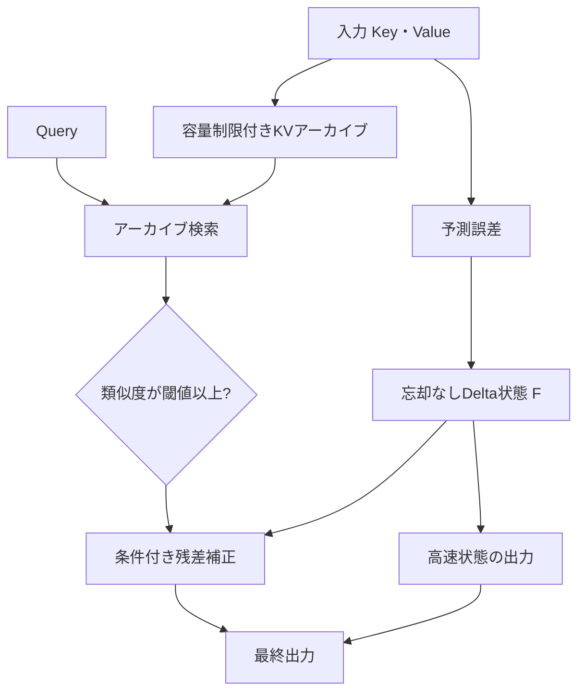

# Summer Delta Attention v5-Gated と Kimi Delta Attention の比較

**著者：summer**  
**日付：2026年10月23日**  
**区分：査読前の研究草稿（合成連想記憶実験）**

## 要旨

Summer Delta Attention v5-Gated（SDA-5）は、忘却ゲートを持たないDelta Ruleの高速状態と、容量制限付きKey–Value（KV）保存領域および類似度しきい値による残差補正を組み合わせた方式である。本研究では、Kimi Delta Attention（KDA）の更新式に基づく未学習・決定論的なチャネル別ゲートモデルと合成連想記憶タスクで比較する。Key次元32、Value次元16、系列長512、128 Query、独立16試行の完全一致Query条件では、KVの50%を保持するSDAの平均二乗誤差（MSE）は **0.4721 ± 0.0099（平均±標準誤差）**、KDA型の再帰更新モデルは **0.9336 ± 0.0098** であった。ただし必要な状態・KV容量はそれぞれ **100 KiB** と **4 KiB** であり、SDAは25倍のメモリを使う。直接KV検索の比較対象は96 KiBで **0.4962 ± 0.0101** となった。この実験は学習済みKimi Linearとの比較ではなく、SDAの一般的優位性を示すものではない。

## 1. 方式



Keyを単位ベクトルとし、状態行列 `F_t` を次で更新する。

\[
 e_t=v_t-F_{t-1}^{\mathsf T}k_t,\qquad
 F_t=F_{t-1}+\beta_t k_t e_t^{\mathsf T}.
\]

保存したKey `k_i` とValue `v_i` のうち、Query `q` に最も類似する `i*` を検索する。類似度が閾値 `τ` を超えた場合だけ補正する。

\[
 o_{\mathrm{SDA}}(q)=F_t^{\mathsf T}q+g(q)\big(v_{i^*}-F_t^{\mathsf T}k_{i^*}\big),
 \quad g(q)=\mathbf1[q^{\mathsf T}k_{i^*}\ge\tau].
\]

## 2. KDA比較モデル

KDAの再帰更新は以下で表される。

\[
 \bar S_t=\operatorname{Diag}(\boldsymbol\alpha_t)S_{t-1},\quad
 S_t=\bar S_t+\beta_tk_t(v_t-\bar S_t^{\mathsf T}k_t)^{\mathsf T}.
\]

比較実装ではチャネル別の減衰を `α_(t,j)=exp[-ℓ c_j(1+η√d |k_(t,j)|)]`、`c_j∈[0.5,1.5]` とする。開発データで選択された正の忘却設定は `β=0.05, ℓ=0.0005, η=0` であり、最終的なゲートはチャネルごとに異なるが時間的には不変である。学習済みゲート、畳み込み、MLAなどKimi Linear全体は再現していない。

## 3. 実験

系列長 `N∈{128,512,2048}`、Key次元32、Value次元16、Query128。Keyは正規乱数から生成してL2正規化し、Valueも独立に正規分布から生成する。Queryは元のKey `k_j` にノイズを加え正規化したもの（`σ∈{0,0.4,1}`）とし、正解は `v_j` である。ハイパーパラメータ選択には8個の開発用seed（20250001～20250008）を用い、結果は未使用の16個のseed（20261023～20261038）で測定した。SDAは開発データから `β=0.05, τ=0.75` を選択した。アーカイブ保存率は10%、25%、50%、100%。全方式に同じデータとノイズを与える。

## 4. 主な結果

| 方式（N=512、ノイズなし） | MSE ± SEM | 状態・KV容量 KiB |
|---|---:|---:|
| 全KV Softmax（鋭い温度） | 約0 | 192 |
| KDA型チャネル別ゲート（未学習） | 0.9336 ± 0.0098 | **4** |
| 忘却なしDeltaNet（調整済み） | 0.9301 ± 0.0098 | **4** |
| SDA v5元設定（50%保存） | 0.9422 ± 0.0221 | 100 |
| **SDA v5調整済み（50%保存）** | **0.4721 ± 0.0099** | 100 |
| インデックスKVのみ（50%保存・不一致時ゼロ） | 0.4962 ± 0.0101 | 96 |

SDAのMSEはKDA型未学習モデルより低いが、記憶容量は25倍である。同一メモリ予算の勝敗ではない。また、全KV Softmaxは全データを保持した鋭いSoftmaxの参考値であり、学習済みFull Attentionの公平な比較ではない。

## 5. 数学的性質・計算量・限界

検索したペア `(k_i,v_i)` と二値ゲート `g` に対して、

\[
 o_{\mathrm{SDA}}(q)=F_t^{\mathsf T}(q-g k_i)+g v_i.
\]

したがって `q=k_i` かつ `g=1` の場合は保存済みValueを厳密に復元できる。ただしこれは **Valueを明示保存したことによる性質** であり、固定サイズメモリだけで無損失記憶を実現したことにはならない。SDAの状態・アーカイブ保存量は `O(d_k d_v + B(d_k+d_v))`、全件走査による検索計算量はQueryごとに `O(B d_k)`。アーカイブが系列長に比例して成長するなら、全体の時間計算量は線形とは限らない。

本研究は学習済みKDAやFull Attentionとの比較、同一メモリ量・同一FLOPsの比較、次トークン予測、GPU速度、ANN検索のオーバーヘッド、自然言語での一般化性能を検証していない。性能の優位性・独自性は未確立である。

## 6. 再現手順

```bash
pip install numpy pandas matplotlib
OPENBLAS_NUM_THREADS=1 python research/experiment.py
OPENBLAS_NUM_THREADS=1 python research/figures.py
```

比較実験は「全書き込み後に固定乱数でKVを選ぶ」方式である。一方、`examples/quickstart.py` はストリーム中にreservoir samplingで保持するサンプルであり、評価プロトコルは異なる。両者の結果を直接同一視しないこと。

## 参考文献

1. Vaswani et al. (2017), *Attention Is All You Need*, https://arxiv.org/abs/1706.03762.
2. Schlag, Irie, Schmidhuber (2021), *Linear Transformers Are Secretly Fast Weight Programmers*, https://proceedings.mlr.press/v139/schlag21a.html.
3. Yang, Kautz, Hatamizadeh (2025), *Gated Delta Networks*, https://arxiv.org/abs/2412.06464.
4. Kimi Team et al. (2025), *Kimi Linear: An Expressive, Efficient Attention Architecture*, https://arxiv.org/abs/2510.26692.
5. Wu et al. (2022), *Memorizing Transformers*, https://arxiv.org/abs/2203.08913.
6. Behrouz et al. (2025), *Titans: Learning to Memorize at Test Time*, https://arxiv.org/abs/2501.00663.

**引用情報：** summer (2026), *Summer Delta Attention v5-Gated と Kimi Delta Attention の比較*, 査読前研究草稿。
